<div align="center">

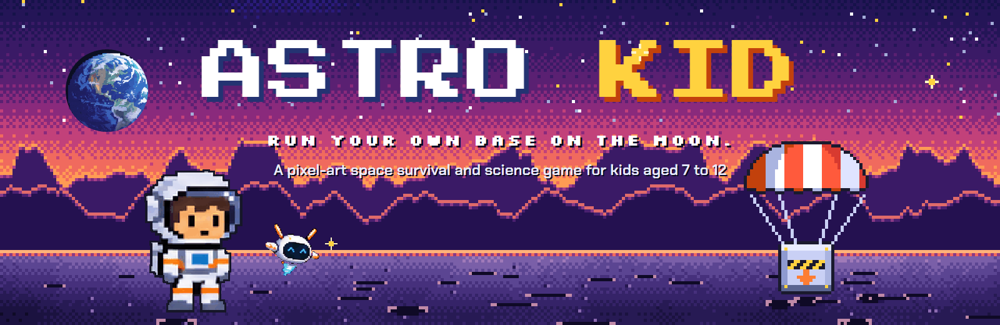

<br>


**You are the Commander of a two-person mission to an unfinished outpost on the Moon.**
Every choice costs something: oxygen, power, time. Explore, collect, research, build and keep the crew alive.

<a href="https://astrokid.site/play.html"></a>
<a href="https://astrokid.site/download.html"></a>
<a href="https://astrokid.site"></a>

**Live at [astrokid.site](https://astrokid.site)**: the browser demo needs no account.

[About](#about) · [Screenshots](#screenshots) · [Missions](#missions) · [Systems](#systems) · [Controls](#controls) · [Play it](#play) · [Status](#status) · [Tech stack](#stack) · [Getting started](#start) · [License](#license)

</div>

<br>

<a id="about"></a>
<h2 align="center">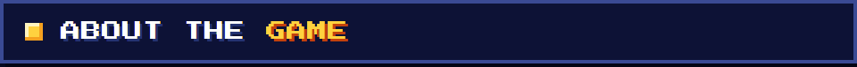</h2>

**Astro Kid** is a 2D top-down space-survival and science game for children aged 7 to 12. A young astronaut lands at a half-built
outpost near the Moon's south pole, the region targeted by NASA's Artemis program. Supplies from Earth are limited, the air is only
temporary and the power is not guaranteed.

The child explores the lunar surface, mines rock samples, researches new technology, builds machines and keeps the base running.
Nothing is free, so every decision is a small mission-planning decision. By playing, a child learns the real constraints that
engineers face on the Moon and Mars, without reading a textbook.

> **Rule of the design:** every mission must leave the child understanding one real constraint of deep-space survival, not just having fun.

This repository holds the whole project, not only the game:

| Part | What it is |
|---|---|
| **Game** | A Phaser 3 game that runs in the browser and, packaged with Electron, as a Windows desktop app. |
| **Website** | A pixel-art marketing site: landing page, About page (full game guide), download and install page, profile page, policies. |
| **Server** | A small Fastify and PostgreSQL API for Google sign-in, accounts, protected installer downloads and account deletion. |
| **Desktop app** | An offline Electron app with a locked-down window, plus an installer. |
| **Docs and deploy** | Design files, specs, and a step-by-step guide to run everything on your own VPS. |

> Astro Kid is an independent educational project. It is not an official NASA product.

<br>

<a id="screenshots"></a>
<h2 align="center">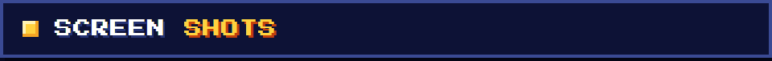</h2>

<table>
  <tr>
    <td width="50%">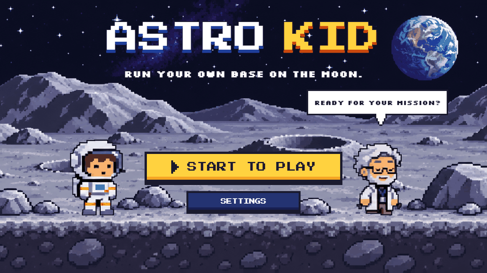</td>
    <td width="50%">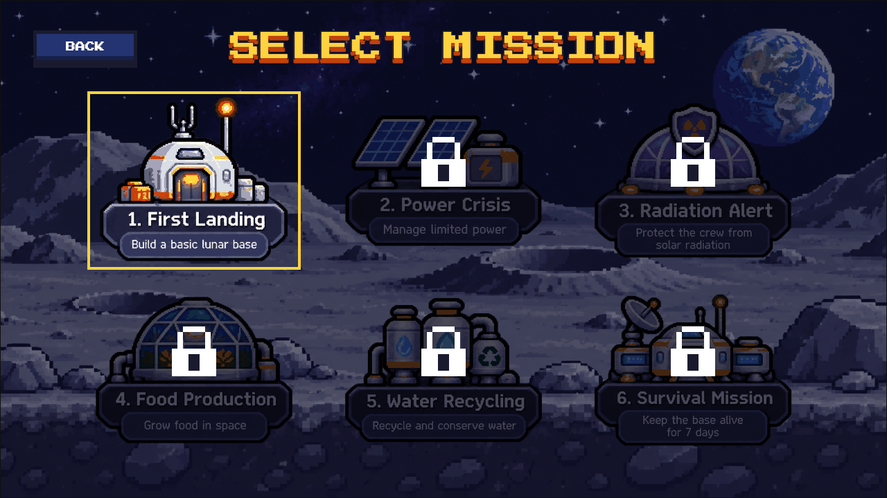</td>
  </tr>
  <tr>
    <td align="center"><sub>Start screen</sub></td>
    <td align="center"><sub>Six linked missions</sub></td>
  </tr>
  <tr>
    <td>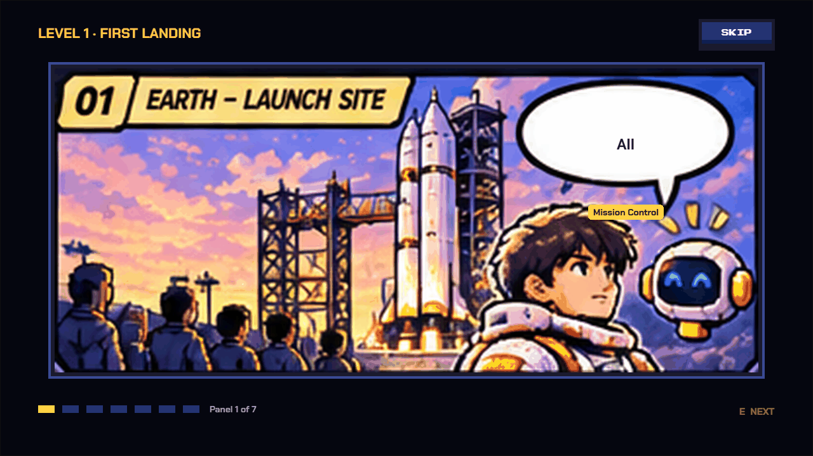</td>
    <td>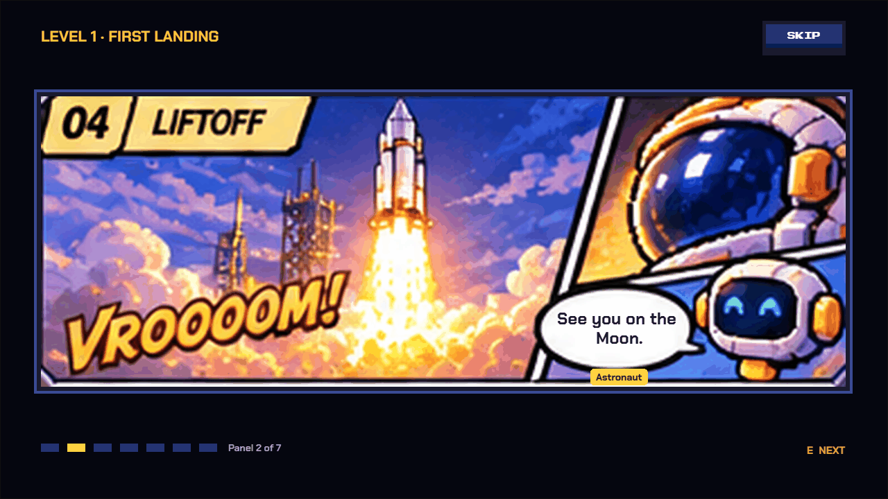</td>
  </tr>
  <tr>
    <td align="center"><sub>Opening story, told as a short manga-style cutscene</sub></td>
    <td align="center"><sub>Launch, transit and landing</sub></td>
  </tr>
  <tr>
    <td>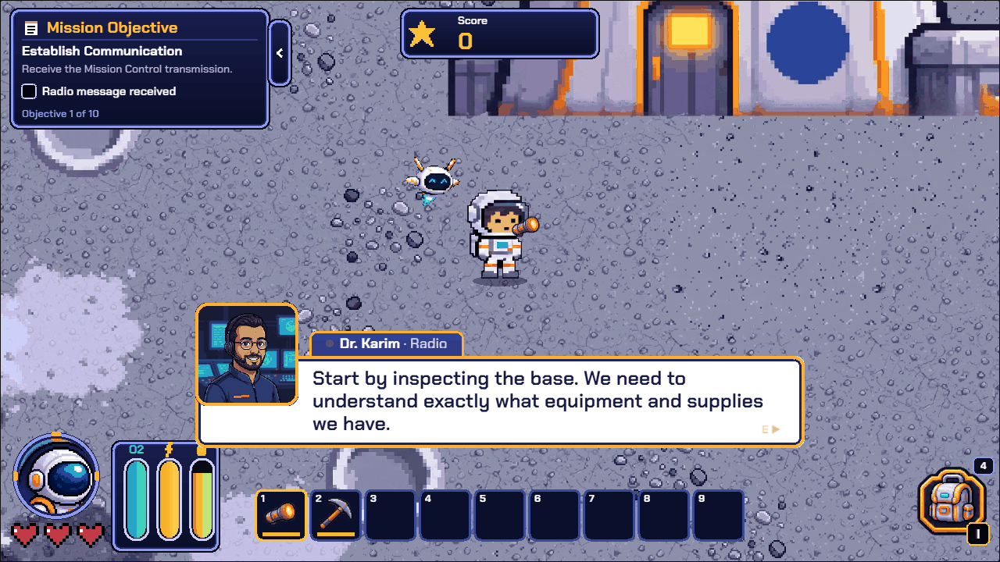</td>
    <td>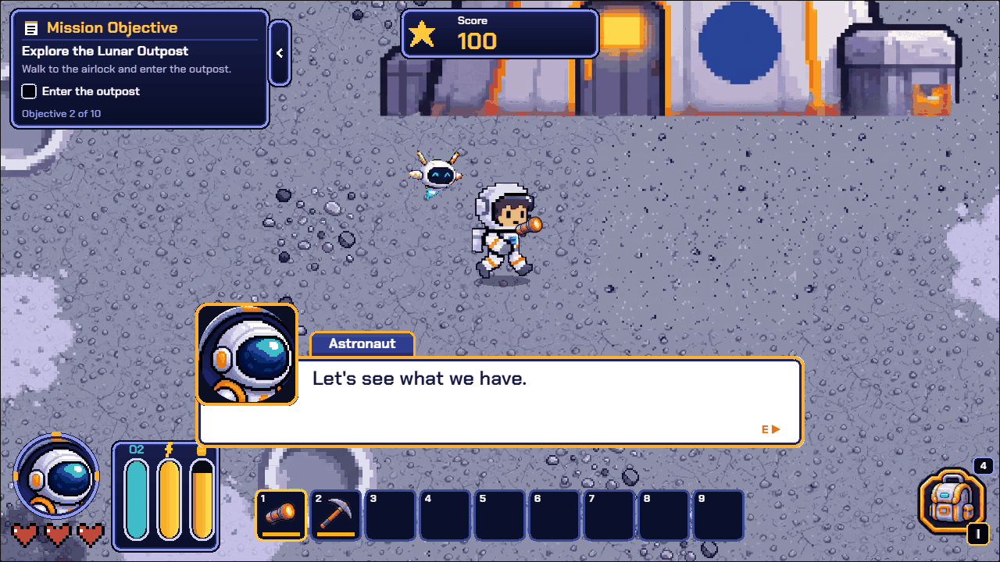</td>
  </tr>
  <tr>
    <td align="center"><sub>Gameplay: objectives, score, status bars and hotbar</sub></td>
    <td align="center"><sub>NOVA explains each system in short, simple sentences</sub></td>
  </tr>
</table>

**The website** shows the same pixel style from the first screen to the download.

<table>
  <tr>
    <td width="50%">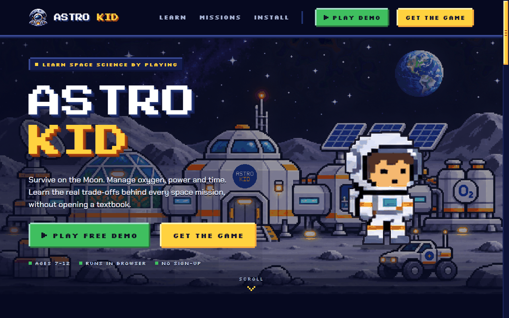</td>
    <td width="50%">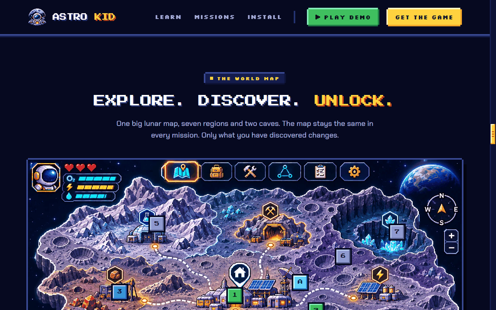</td>
  </tr>
  <tr>
    <td align="center"><sub>Landing page</sub></td>
    <td align="center"><sub>About page: the world map, explained</sub></td>
  </tr>
  <tr>
    <td>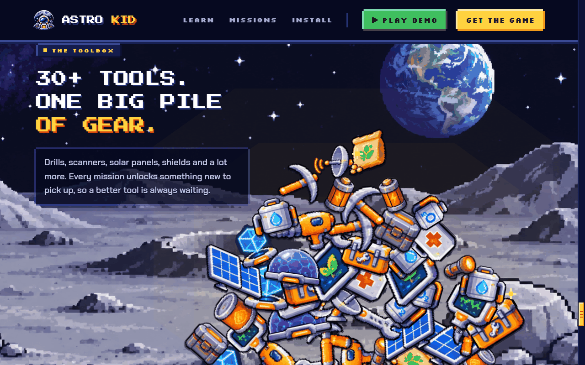</td>
    <td>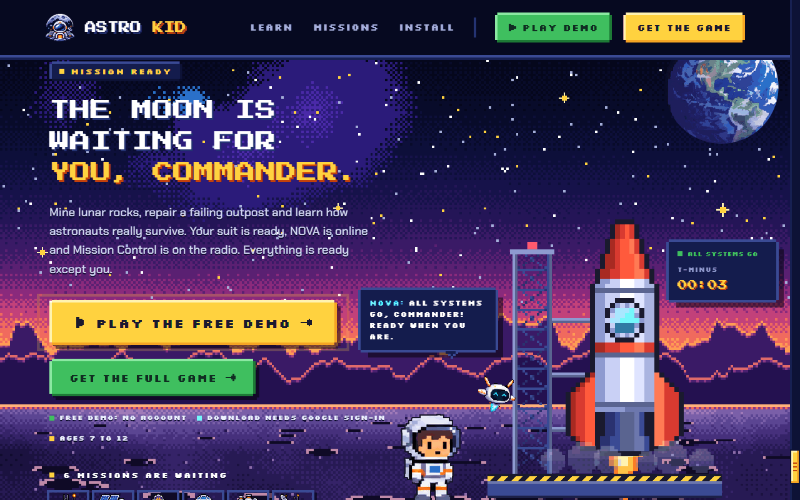</td>
  </tr>
  <tr>
    <td align="center"><sub>The toolbox</sub></td>
    <td align="center"><sub>Ready for launch</sub></td>
  </tr>
</table>

<br>

<a id="plays"></a>
<h2 align="center"></h2>

The player walks freely in eight directions across a large lunar map. Every mission repeats the same loop:

<p align="center">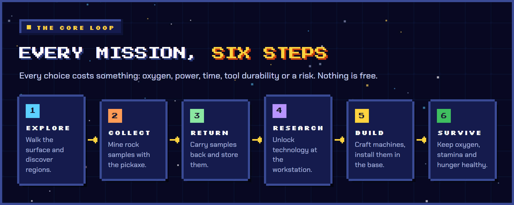</p>

<details>
<summary><b>Text version</b></summary>

| Step | What the player does |
|---|---|
| **Explore** | Walk the surface, discover new regions, read the minimap and the full map. |
| **Collect** | Break rocks with the pickaxe. The pickaxe wears out, so every hit matters. In dark caves, switch on the flashlight (its battery runs down). |
| **Return** | Carry the samples back to the outpost and store them. |
| **Research** | Use the Workstation to open the full-screen Technology Tree and unlock new abilities. |
| **Build** | Craft machines from samples and parts, then install them in the outpost. |
| **Survive** | Keep oxygen, stamina and hunger healthy, protect the crew from the mission's challenge and finish the objectives. |

</details>

Score comes from completing objectives, collecting samples, discovering areas, researching and crafting. Repeating the same action
does not give endless points. There are no stars and no rankings: a mission is a mission, and a report at the end lists objectives,
resources, research and rewards.

<br>

<a id="learn"></a>
<h2 align="center"></h2>

The game turns real engineering trade-offs into gameplay:

<p align="center">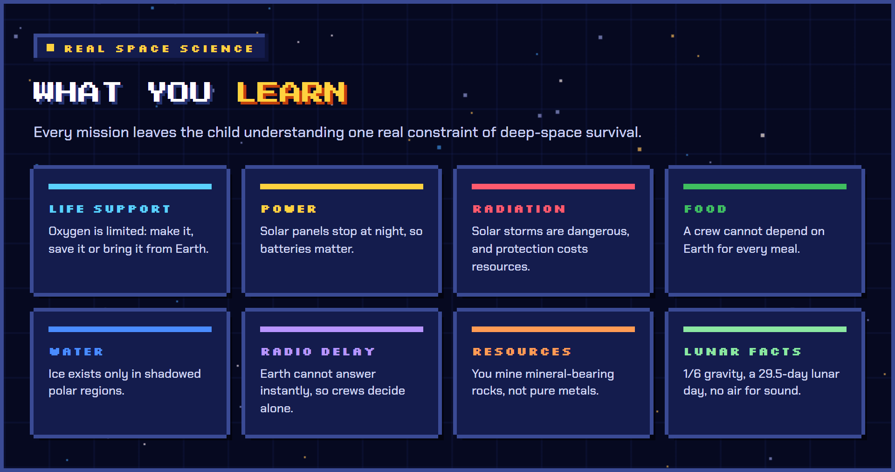</p>

<details>
<summary><b>Text version</b></summary>

| Topic | The idea the child meets |
|---|---|
| **Life support** | Oxygen is limited. It must be made, saved or brought from Earth. |
| **Power budgeting** | Solar panels stop at night, so batteries and storage matter. |
| **Radiation shielding** | Solar storms are dangerous, and protection costs resources. |
| **Food production** | A crew cannot depend on Earth for every meal. |
| **Water** | Ice exists only in some shadowed polar regions and has to be found and recycled. |
| **Communication delay** | Earth cannot answer instantly, so crews must decide for themselves. |
| **Resource science** | Players collect mineral-bearing rocks, not pure metals. Iron and titanium come from minerals like ilmenite, silicon from silicate rocks, and regolith is a mix of dust and fragments. |
| **Lunar facts** | Gravity is about one sixth of Earth's, a lunar day lasts about 29.5 Earth days, and there is no air to carry sound. |

</details>

<br>

<a id="missions"></a>
<h2 align="center"></h2>

The six missions are linked: the base, supplies, research and discovered map carry over from one to the next.

<p align="center">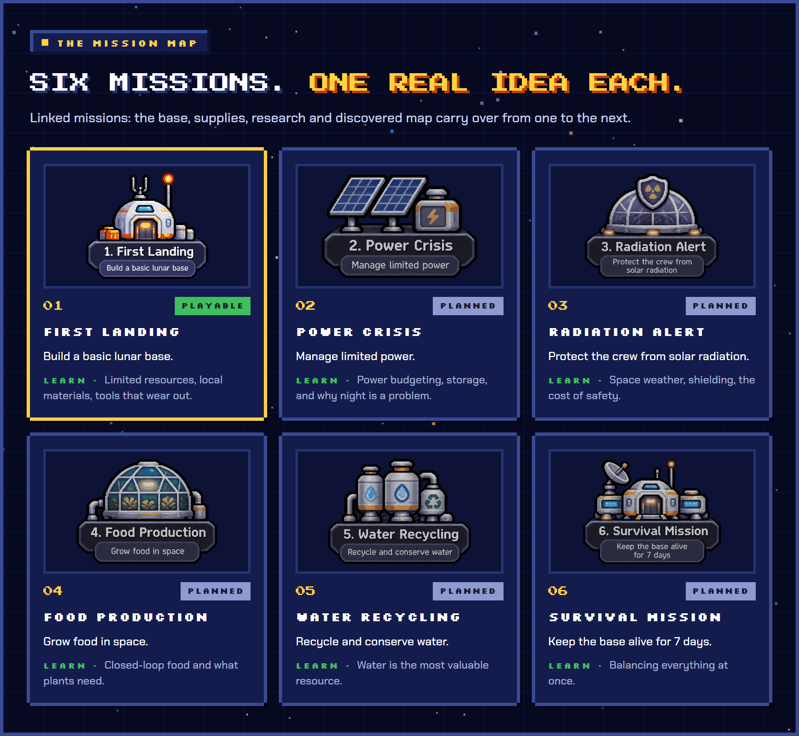</p>

<details>
<summary><b>Text version</b></summary>

| # | Mission | Goal | The child learns | Status |
|---|---|---|---|---|
| 1 | **First Landing** | Build a basic lunar base | Resources are limited, local materials matter, tools wear out, and no mineral is a pure metal | **Playable** |
| 2 | **Power Crisis** | Manage limited power | Power budgeting and storage, and why night is a problem on the Moon | Planned |
| 3 | **Radiation Alert** | Protect the crew from solar radiation | Space weather, shielding, and the cost of safety | Planned |
| 4 | **Food Production** | Grow food in space | Closed-loop food, plant needs, and why growing food in space is hard | Planned |
| 5 | **Water Recycling** | Recycle and conserve water | Water is the most valuable resource, and how crews reuse it | Planned |
| 6 | **Survival Mission** | Keep the base alive for 7 days | Balancing everything at once, the real job of a mission planner | Planned |

</details>

A later **Mars** version follows the same ideas with weaker sunlight, dust storms and a long communication delay, so urgent events
must be handled alone.

**Mission 1 in detail.** The player makes contact with Earth, inspects the four outpost systems, equips the flashlight and pickaxe,
explores the plains, collects 5 samples of each of three rock types, stores them, researches *Basic Material Processing* and builds
the first Material Processor.

<br>

<a id="systems"></a>
<h2 align="center"></h2>

### The world map

<p align="center">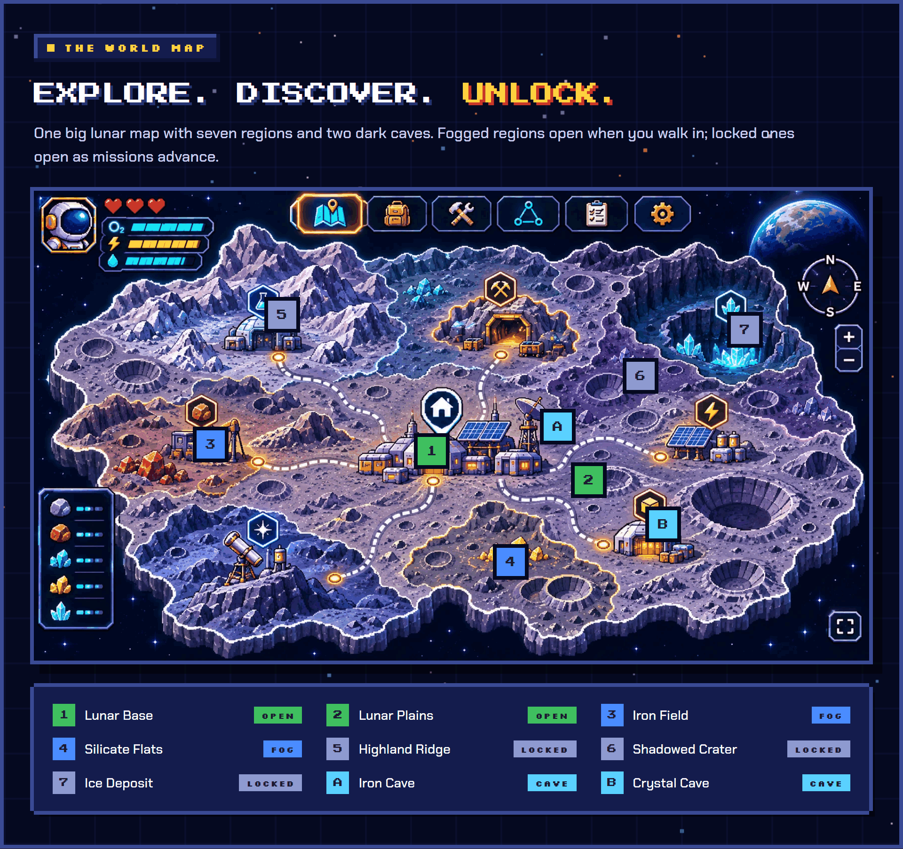</p>

One large lunar map (7,680 × 2,880 px). The map stays the same in every mission; only what you have discovered changes.

<details>
<summary><b>Text version</b></summary>

| Region | State at the start |
|---|---|
| Lunar Base, Lunar Plains | Open |
| Iron Field, Silicate Flats | Hidden by fog until you walk in |
| Highland Ridge, Shadowed Crater, Ice Deposit | Locked until later missions (ice also needs the right protection and equipment) |
| Iron Cave, Crystal Cave | Dark caves in the plains, entered with the flashlight |

</details>

Entering a new region shows its name and gives a discovery bonus. A round minimap follows the player, and a full map opens on `M`.

### Inside the outpost

| System | What it does |
|---|---|
| **Workstation** | Opens the Technology Tree. |
| **Supply Storage** | Holds 3 oxygen canisters, 5 canned food, 4 spare batteries and 1 spare parts kit. |
| **Life Support** | A temporary reserve of about 72 hours (a game setting, not real engineering). |
| **Sleeping Area** | Restores stamina, while time keeps moving. Available later. |

### Technology Tree

Six branches of research: **Tools**, **Life Support**, **Power**, **Agriculture**, **Construction** and **Exploration**. Finishing a
node unlocks a tool or a machine; later nodes stay locked until more missions are done. The first machine is the **Material
Processor**, a simple machine that crushes and sorts lunar samples (5 regolith, 5 iron-bearing rock, 5 silicate rock and 1 spare
parts kit).

<p align="center">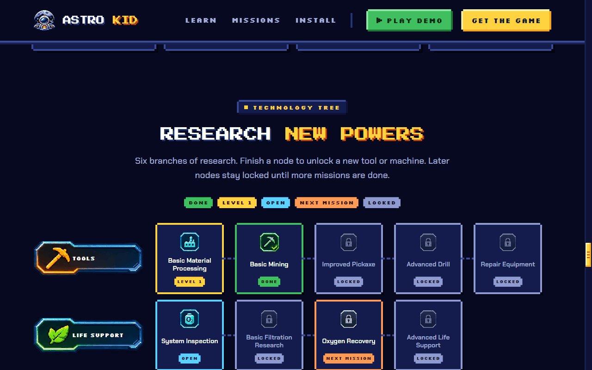</p>

### Tools

Fifteen tools, one job each: Mining Drill, Pickaxe, Wrench, Scanner, Build Tool, Repair Kit, Medkit, Oxygen Tank, Water Purifier,
Soil Analyzer, Seed Planter, Harvest Tool, Solar Panel Kit, Shield Generator and Beacon. Tools unlock as missions advance.

<br>

<a id="crew"></a>
<h2 align="center"></h2>

<p align="center">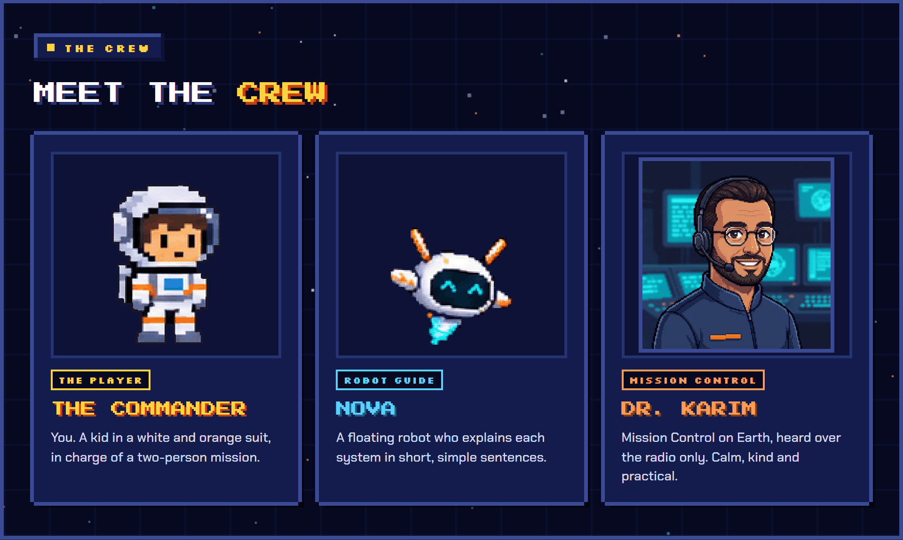</p>

<details>
<summary><b>Text version</b></summary>

| Character | Role |
|---|---|
| **The Commander** | You. A kid in a white and orange suit with a blue visor, in charge of a two-person mission. |
| **NOVA** | A small floating robot. Guide, tutor and the voice that explains how each system works, in short, simple sentences. Friendly and curious. |
| **Dr. Karim** | Mission Control on Earth, heard over the radio only. Calm, kind and practical. On the Moon his answers arrive almost at once; on Mars they take a long time. |

</details>

<br>

<a id="controls"></a>
<h2 align="center"></h2>

<p align="center">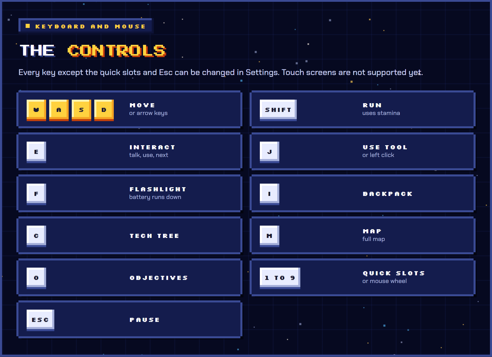</p>

<details>
<summary><b>Text version</b></summary>

| Action | Default keys |
|---|---|
| Move | `W` `A` `S` `D` or the arrow keys |
| Run (uses stamina) | `Shift` |
| Interact, advance dialogue | `E` |
| Use the tool | `J` or a left click |
| Flashlight | `F` |
| Backpack | `I` |
| Technology Tree | `C` |
| Map | `M` |
| Objectives | `O` |
| Quick slots | `1` to `9`, or the mouse wheel |
| Pause | `Esc` |

</details>

The game is made for a computer with a keyboard and a mouse. Touch screens are not supported yet.

<br>

<a id="play"></a>
<h2 align="center"></h2>

| Way to play | How |
|---|---|
| **In the browser (free demo)** | **[astrokid.site/play.html](https://astrokid.site/play.html)**. No account is needed. Or run it yourself with the steps in [Getting started](#start). |
| **On Windows (full game)** | **[astrokid.site/download.html](https://astrokid.site/download.html)**: sign in with Google, then download `AstroKid-Setup.exe` (Windows 10 / 11, 64-bit). The installer is built from this repository. |

> **The demo is an early version.** It is the current, unfinished build. Only the first mission is playable, many parts are still
> missing or rough, and things may break. In the browser the progress is saved only in that browser and may be reset when the
> demo is updated. The game says this clearly before you start.

<br>

<a id="status"></a>
<h2 align="center"></h2>

| Area | State |
|---|---|
| Mission 1, *First Landing* | Playable |
| Missions 2 to 6 | Designed in [`docs/specs`](docs/specs), not built yet |
| Website (landing, About, download, profile, policies, error pages) | Built |
| Sign-in with Google, accounts, protected download, account deletion | Built (needs your own Google OAuth keys and a PostgreSQL database) |
| Free browser demo with an "early version" notice | Built |
| Windows desktop app (offline) | Built and tested |
| Installer | The standard NSIS installer works. A custom pixel-art installer is an experiment. |
| Code signing | Not done, so Windows SmartScreen shows a warning for new installers |
| Game account | Not needed: the game runs offline. The Google account is only for the download |
| Sign-up overview | `npm run signups` on the server, plus an optional Telegram ping per sign-up |
| Mobile and touch support | Not supported yet |
| Mars version | Planned |

<br>

<a id="stack"></a>
<h2 align="center"></h2>

| Layer | Technology |
|---|---|
| Game | [Phaser](https://phaser.io) 3.80, plain JavaScript (ES modules) |
| Website | [Vite](https://vitejs.dev) 5 multi-page site, vanilla HTML, CSS and JavaScript, no UI framework |
| API | Node.js 20+, [Fastify](https://fastify.dev) 5, Zod, `google-auth-library` |
| Database | PostgreSQL |
| Desktop | [Electron](https://www.electronjs.org) 33, electron-builder 25 |
| Hosting | One Linux VPS with Docker Compose: PostgreSQL, the API, nginx and a nightly backup, each in its own container |

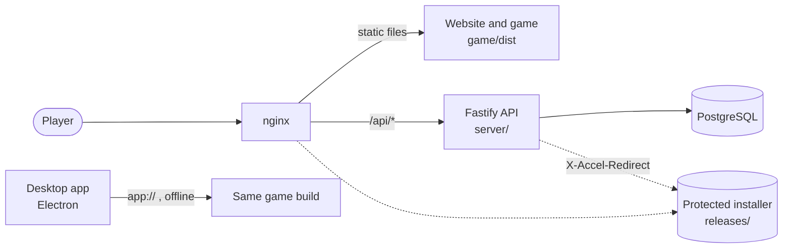

<br>

<a id="layout"></a>
<h2 align="center"></h2>

```text
Astro-Kid/
├── game/            Phaser 3 game and the Vite website
│   ├── src/         game scenes, systems and data (src/site = website code)
│   ├── public/      art, audio, fonts and static files
│   └── *.html       landing, about, download, profile, policies, play
├── server/          Fastify API, PostgreSQL migrations and tests
├── desktop/         Electron app (main.js, preload.js, scripts, tests)
│   └── installer/   experimental custom installer
├── deploy/          Docker files and guides (DOCKER.md, DEPLOY.md)
├── docker-compose.yml
├── docs/
│   ├── specs/       the game specs (missions, systems, maps)
│   ├── design/      the HTML design files for every screen
│   └── readme/      images used by this README
├── LICENSE
└── THIRD_PARTY_NOTICES.md
```

<br>

<a id="start"></a>
<h2 align="center">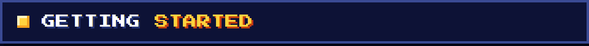</h2>

You need **Node.js 20 or newer**. PostgreSQL is needed only for the server.

### Run the game and the website

```bash
git clone https://github.com/abdallah244/Astro-Kid.git
cd Astro-Kid

npm run install:game
npm run dev                      # http://localhost:5173
```

Open `http://localhost:5173/play.html` to play the demo, or `/` for the website.

To try the sign-in screens without a server, create `game/.env.local` with a fake Google sign-in:

```bash
VITE_MOCK_AUTH=true
```

### Run the API (optional)

```bash
npm run install:server
cp server/.env.example server/.env      # then fill in the values
npm run migrate:server
npm run dev:server                      # http://localhost:3000
npm run test:server
```

`server/.env` needs `DATABASE_URL`, `SITE_ORIGIN`, `GOOGLE_CLIENT_ID`, `GOOGLE_CLIENT_SECRET` and `GOOGLE_REDIRECT_URI`. The secrets
live only on the server; the game and the website contain no keys.

### Build the Windows desktop app

```bash
cd desktop
npm install
npm start                # runs the game in the Electron window
npm test                 # unit tests
npm run smoke            # starts the app twice and checks offline fonts, lockdown and saved data
npm run dist:dir         # dist/win-unpacked/Astro Kid.exe
npm run dist:nsis        # dist/AstroKid-Setup.exe (standard installer)
```

If your terminal sets `ELECTRON_RUN_AS_NODE=1`, unset it first, or the app starts as plain Node and prints a version number.

### Production build

```bash
npm run build            # game/dist, ready to serve with nginx
```

<br>

<a id="deploy"></a>
<h2 align="center"></h2>

The recommended way is Docker Compose: one command starts the database, the API, the web server and a nightly backup, isolated
from anything else on the VPS. The full guide (secrets, Google sign-in, HTTPS, seeing who signed up, publishing the installer,
backups) is in **[`deploy/DOCKER.md`](deploy/DOCKER.md)**.

```bash
cp .env.docker.example .env      # fill in the values
docker compose up -d --build
docker compose exec api npm run signups
```

A manual setup without Docker (systemd and host nginx) is described in [`deploy/DEPLOY.md`](deploy/DEPLOY.md).

<br>

<a id="security"></a>
<h2 align="center">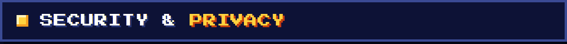</h2>

- **Sign-in:** Google OAuth 2.0 authorization-code flow with PKCE, handled on the server. The app never sees a Google password.
- **Sessions:** random tokens in `HttpOnly` cookies; only a SHA-256 hash of the token is stored in the database.
- **Requests:** CSRF protection by origin check, rate limiting, secure headers (Helmet) and a strict Content-Security-Policy in nginx.
- **Data:** a profile (the full name and the consent record) cannot be edited once created; a database trigger enforces it.
- **Deleting an account:** the only delete button is on the profile page. It asks for a typed confirmation and removes the account,
  the profile and the sessions. Backups older than 30 days are deleted automatically.
- **Downloads:** the installer is served through a protected nginx location and only to signed-in users with a profile.
- **Desktop app:** sandboxed window, `contextIsolation`, no Node in the page, a Content-Security-Policy, all external network
  requests blocked, no developer tools in the packaged app.
- **The demo:** needs no account, calls no API and collects no personal data.

The legal texts are on the website's policies page (Privacy Policy, Terms of Use, Account Deletion Policy).
If you find a security problem, please write to the address below instead of opening a public issue.

<br>

<a id="license"></a>
<h2 align="center"></h2>

Astro Kid is released under the **[Astro Kid License](LICENSE)**: the same personal-use license as on the website. In short:

| You can | You cannot |
|---|---|
| Play the game and install it on your own devices | Sell, rent or resell it, or profit from redistributing it |
| Use it for personal, non-commercial learning and entertainment | Reverse engineer it, modify it or publish derivative works |
| Read the source code for reference and learning | Re-upload the installer or the files to other sites |
| | Use the name, logo, characters or artwork in another project |

This is **source-available, not open source**: the code is public to read, and all rights are reserved by the author. The
license is **not** a replacement for the legal text; read [`LICENSE`](LICENSE) for the exact terms. To ask for permission to do
anything it does not allow, write to the address below.

The open-source libraries and fonts the project uses keep their own licenses: see
**[`THIRD_PARTY_NOTICES.md`](THIRD_PARTY_NOTICES.md)** (Phaser, Electron, Fastify, PostgreSQL driver, Press Start 2P, Silkscreen,
Chakra Petch and others).

Designed and developed by **[Abdallah Hany](https://github.com/abdallah244)**, an independent developer.

<br>

<a id="contact"></a>
<h2 align="center">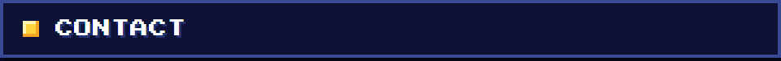</h2>

Questions, permissions, bug reports and feedback on the demo: **abdallahhfares@gmail.com**

<div align="center">


<sub>© 2026 Astro Kid. All rights reserved. Made by Abdallah Hany.</sub>

</div>
